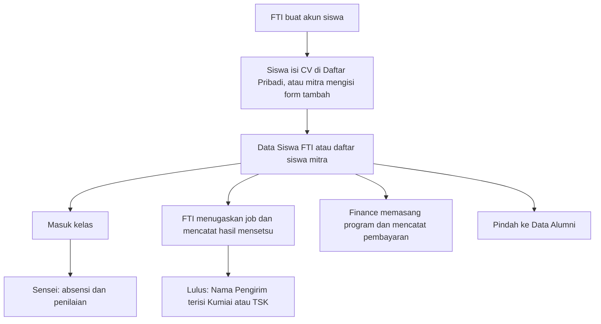

# Alur Flora Talent Indonesia

Dokumen ini mengikuti aplikasi yang ada sekarang. Login belum dipakai. Dari halaman depan, pengguna memilih portal. Data demo tersimpan di browser perangkat itu, belum ke server.

## Peta portal

Halaman `/` menampilkan delapan pintu:

| Portal | Jalan | Siapa yang memakainya |
|---|---|---|
| LPK Mitra | `/lpk-mitra` | Admin LPK, demo-nya LPK Mitra Sukabumi |
| FTI | `/fti` | Admin Flora Talent Indonesia |
| YS | `/ys` | Partner di Jepang, tampilan bahasa Jepang |
| Daftar Siswa | `/daftar-pribadi` | Calon siswa yang mengisi CV sendiri |
| Guru | `/guru-dashboard` | Sensei |
| Finance Dashboard | `/finance` | Keuangan |
| Dokumen | `/dokumen` | Staff dokumen |
| Account Management | `/account-management` | Pengelola akun staff portal |

Tombol Keluar di tiap portal hanya kembali ke halaman depan.

## ID peserta

Ada dua macam ID, dan keduanya tidak dipotong kalau angkanya sudah panjang.

**Siswa FTI.** `FTI` + dua digit angkatan + urutan, minimal tiga digit. Contoh: `FTI05001`, `FTI24001`. Urutan ke-1000 tetap utuh, misalnya `FTI051000`. Dua digit angkatan hanya diisi saat FTI membuat akun siswa. Itu bukan filter angkatan di tabel.

**LPK mitra.** Saat FTI membuat LPK, kodenya `MFTI` + urutan LPK, minimal dua digit: `MFTI01`, `MFTI100`. Kode ini tampil di daftar LPK, tidak tampil di halaman buat akun. Siswa pertama LPK itu `MFTI01001`. Siswa ke-1000 menjadi `MFTI011000`. Alamat halamannya `/fti/lpk-mitra/lpk-01`, bukan `lpk-001`.

Di seluruh tampilan, sebutannya **ID Peserta**.

## Jalan siswa, dari akun sampai alumni

Siswa masuk Data Alumni dengan dua cara. Admin menekan Assign to Alumni di form edit, atau tanggal perkiraan masuk Jepang sudah lewat. Data profil yang sudah ada tidak dihapus. Tabel alumni hanya menampilkan kolom tracking, dan kolom itu diubah lewat Edit.

Perkiraan pulang bisa diisi manual. Kalau kosong, Ikusei dihitung tiga tahun dan TG lima tahun dari tahun perkiraan masuk Jepang.

## LPK Mitra

Demo portal ini adalah LPK Mitra Sukabumi, kode `MFTI01`. Di beranda terlihat masa berlaku MOU, sisa hari, contact person, dan nama berkas. Kalau MOU habis, login LPK ditutup, tetapi data siswa tidak dihapus.

**Kelola Siswa** (`/lpk-mitra/siswa`). Daftar siswa LPK itu. Admin bisa menambah, mengedit, mengunduh Excel, dan membuka CV. LPK tidak bisa menghapus siswa. Yang menghapus adalah FTI dari halaman LPK tersebut.

**Tambah Siswa** (`/lpk-mitra/siswa/tambah`). Form bertahap: identitas, fisik, pendidikan, pekerjaan, sertifikat, keluarga, tujuan, lalu program. ID peserta diisi otomatis dari urutan LPK, tidak diketik. Kontak darurat (nama, hubungan, telepon) ada di langkah identitas.

**Job** (`/lpk-mitra/kyujin`). LPK hanya melihat job yang FTI bagikan ke LPK itu, termasuk PDF kyujin kalau sudah diunggah.

## FTI

**Daftar LPK Mitra** (`/fti/lpk-mitra`). Kartu tiap LPK menampilkan kode `MFTI`. Membuka kartu masuk ke siswa LPK itu. Dari sini FTI bisa mengubah data siswa dan menghapus siswa.

**Buat Akun LPK Mitra** (`/fti/create-lpk-mitra`). Form membuat akun LPK. ID tidak ditampilkan di form. Setelah tersimpan, ID muncul di daftar LPK. Password LPK bisa diganti dari sini. MOU (tanggal akhir dan berkas) diisi di data akun LPK.

**Buat Akun Siswa** (`/fti/add-account`). FTI mengisi angkatan dua digit, nama, dan password. Sistem membuat ID Peserta `FTI` + angkatan + urutan. Akun yang sudah dibuat tetapi belum mengisi data muncul sebagai angka di Data Siswa FTI.

**Student Account Management** (`/fti/student-account-management`). Mengelola akun yang sudah ada: cari nama atau ID, filter kelas dan status, ganti password, aktif atau nonaktif, dan menempatkan kelas. Akun nonaktif disembunyikan dari daftar siswa.

**Data Siswa FTI** (`/fti/data-siswa-fti`). Tabel profil siswa FTI, dan bisa disaring ke satu LPK mitra. Filter yang ada: kelas (khusus sumber FTI) dan sumber. Tidak ada filter angkatan.

Kolom yang terlihat antara lain ID Peserta, foto, nama (katakana di atas nama), kelas, program, job, hasil, riwayat, tanggal lahir, jenis kelamin, telepon, email, asal LPK, nama pengirim, perusahaan, tanggal kelulusan, perkiraan masuk Jepang, tanggal keberangkatan, serta dokumen, MCU, dan sertifikat lewat tombol Lihat. Edit membuka seluruh profil: biodata, kontak darurat, medis, keluarga, pendidikan, pekerjaan, sertifikat, program, jadwal, dan pindah ke alumni.

Nama Pengirim tidak diketik di tabel. Nilainya datang dari job: Kumiai kalau program ikusei, TSK kalau program TG, dan hanya setelah hasil mensetsu lulus.

Unduh data membuka pilihan Excel atau CV. Excel memuat profil yang lebih lebar dari kolom tabel, termasuk kontak darurat. File scan tidak ikut di Excel.

**Job Assignment** (`/fti/job-assignment`). FTI membuat job (kotak form dua kolom). Pengirim diisi kumiai untuk magang dan TSK untuk TG. Perusahaan adalah nama kaisha. Job bisa ditugaskan ke siswa, lalu hasil mensetsu dicatat. PDF kyujin diunggah di sini kalau LPK perlu melihatnya.

**Data Alumni** (`/fti/data-alumni`). Siswa yang sudah pindah atau yang tanggal masuk Jepangnya sudah lewat. Bisa tambah data alumni langsung. Edit mengubah kolom tracking: TSK, tanggal rekrut, mensetsu, naitei, sertifikat JFT dan SSW, paspor, visa, COE, EKTKLN, keberangkatan, N3, SIM Jepang, dan perkiraan pulang.

**Ganti password** admin FTI ada di `/fti/change-password`.

## Daftar Pribadi

Siswa membuka `/daftar-pribadi`.

Kalau CV belum ada, beranda mengingatkan untuk mengisi form. **Form CV** (`/daftar-pribadi/cv-form`) langkahnya sama dengan tambah siswa mitra, termasuk kontak darurat. Menyimpan CV memasukkan siswa itu ke Data Siswa FTI. Kalau ID-nya sudah ada di daftar, isian Edit di FTI tidak ditimpa oleh CV lama.

**Profil** (`/daftar-pribadi/profil`) menampilkan CV yang sudah disimpan dan dokumen pendukung yang sudah diunggah.

## Guru

**Kelas** (`/guru-dashboard/kelas`). Sensei membuat dan mengubah kelas per TC Bogor atau Jakarta, memilih jalur penilaian, dan mengatur jumlah pertemuan. Kelas bisa dinonaktifkan atau dihapus. Data kelas tersimpan.

**Absensi** (`/guru-dashboard/absensi`). Per kelas dan jalur. Tiap pertemuan punya tanggal dan tanda Hadir, Izin, Sakit, atau Alpha. Isian absensi tersimpan.

**Penilaian** (`/guru-dashboard/progress-belajar`). Aspek mengikuti jalur kelas: kosakata, chokai, tata bahasa, kanji, kaiwa, sikap, praktek, dan praktek kaigo. Sensei bisa mengedit nilai, mengunduh, dan mencetak. Nilai ini masih hidup di halaman saja. Belum ada server, jadi angka contoh teracak lagi setiap halaman dibuka, dan edit sensei belum menetap. Form sertifikat ada di `/guru-dashboard/progress-belajar/certificate-form`.

Daftar nama di absensi dan penilaian masih daftar kelas sensei, belum menyatu penuh dengan setiap ubahan di Data Siswa FTI.

## YS

Partner Jepang membuka **Job Management** (`/ys/jobs`). Daftar job mengikuti Job Assignment FTI. YS melihat siswa yang ditugaskan. YS tidak membuat ID peserta dan tidak mengedit profil siswa.

## Finance

Lima program resmi, dengan nominal tetap:

1. Job Matching
2. Ikusei Kojin
3. Ikusei Partner / Rekanan FTI
4. Magang
5. Kelas Reguler

Alurnya: siswa yang belum masuk program ada di antrean. Finance memilih sumber dan kelas, lalu memasang program. Invoice terbentuk per tahap. Tiap baris bisa ditandai lunas, dikembalikan ke belum lunas, diubah tanggalnya, dan diberi catatan. Ada tampilan yang sudah lunas dan yang masih berjalan. Kwitansi dan invoice bisa dicetak. Antrean bisa diunduh ke Excel. ID Peserta tampil di antrean. Tidak ada filter angkatan.

## Dokumen

**Lihat Data** (`/dokumen/data`) menampilkan batch dokumen yang sudah dibuat.

**Buat Dokumen** (`/dokumen/buat`) menyusun batch, misalnya COE, lalu mengisi data bersama dan data tiap siswa. Status tiap orang bisa belum, draft, atau selesai. Batch tersimpan, bisa dibuka lagi dan dihapus.

**Ganti password** staff dokumen ada di `/dokumen/ganti-password`.

## Account Management

`/account-management` membuat akun staff dan memilih portal yang boleh dibuka: FTI, YS, Guru, Finance, atau Dokumen. Akun bisa diubah namanya, diganti passwordnya, dinonaktifkan, atau dihapus. Akun admin FTI terkunci agar akses FTI-nya tidak hilang.

Pintu login belum dipasang. Menyimpan akun di sini belum menghalangi orang membuka portal dari halaman depan.

## Tabel siswa

Daftar siswa FTI, daftar siswa mitra, dan data alumni memakai aturan yang sama.

- Baris per halaman mulai dari 15. Pilihan lain: 25, 50, 100, atau kustom.
- Tinggi tabel mengikuti sisa layar, baik 16:9 maupun 16:10. Halaman di luar tabel tidak bergulir. Kalau baris lebih panjang dari layar, yang bergulir adalah isi tabel.
- Kolom yang menempel (nomor, ID, nama, aksi) tetap lurus dengan kepalanya saat digulir.
- Kalau data pada halaman itu kurang dari 15 baris, tabel menyusut sampai baris terakhir.

## Yang sengaja belum

- Login dan penjagaan portal. Akun staff sudah bisa dicatat, tetapi pintu masih terbuka.
- Nilai sensei belum punya tempat simpan tetap.
- Absensi dan penilaian belum membaca setiap perubahan profil dari Data Siswa FTI.
- Tidak ada backend. Semua simpanan ada di browser ini.
